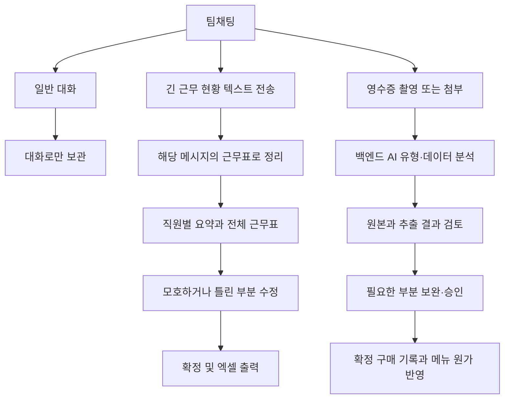

# ZC FNB 화면·기능 재설계 계획서

> 후속 계획: 화면 구조·원가·회계·은행 범위는 [Restaurant365 전체 UI 재설계 V2](ZC_FNB_R365_FULL_UI_PLAN_V2.md)를 우선 적용합니다. 아래는 이전 계획 기록입니다.

작성일: 2026-10-28

상태: 설계안. 이 문서를 작성하며 앱 코드·실서버 설정은 변경하지 않았다. API 경로·JSON은 협의용 제안이며 백엔드 구현을 확인한 명세가 아니다. 기존 구현 비교는 [Restaurant365 검토 기록](RESTAURANT365_REFERENCE_REVIEW.md)을 함께 참고한다.

## 1. 이번에 확정한 요구사항

1. ZC FNB의 중심은 직원들이 실제로 일상 대화를 나누는 팀채팅이다.
2. **일반 대화를 전부 검사하거나, 짧은 대화에서 근무를 자동 추론하지 않는다.** 직원별 날짜·출퇴근 시간·합계가 적힌 긴 근무 현황 텍스트를 채팅에 올리고, 해당 메시지에서 근무표 정리를 실행한다.
3. 영수증은 기존처럼 ‘영수증 올리기’로 촬영·파일 첨부한다. **업로드 전 수기/인쇄/전자/PDF 유형 선택과 형식 변경 단계를 없앤다.**
4. 영수증의 문서 종류와 포함 데이터는 백엔드의 AI agent가 분석한다. 프론트는 백엔드 API 응답을 검증·변환해 표시하고 사람이 보완·확정할 화면을 제공한다.
5. 업무 화면은 Restaurant365의 내비게이션·표·상태별 보기·원본 대조·상세 패널을 구체적으로 참고한다. 채팅방은 카카오톡처럼 대화와 입력에 집중하는 전체 화면을 유지한다.
6. 현재 잘 동작하는 전체 요약·문제 행 검토·엑셀·사업장 전환·입력 보호는 유지한다.

## 2. 사용자 경험의 중심 흐름



근무표 분석·영수증 OCR의 실패나 지연이 일반 메시지 송수신을 막지 않도록 별도 작업으로 취급한다. 분석이 끝나도 검토 없이 업무 기록을 자동 확정하지 않는다.

## 3. 화면 구성과 Restaurant365 적용 방식

### 공통 업무 화면

PC에서는 고정 왼쪽 내비게이션, 상단 사업장·기간 선택·검색·사용자 메뉴, 본문 업무 표, 선택 항목의 상세 패널로 구성한다. 단순 링크를 기능 없는 메뉴처럼 보이게 배치하지 않는다.

왼쪽 메뉴는 ‘홈 / 팀채팅 / 문서·구매 / 메뉴·원가 / 근무표 / 입고 검수 / 설정’으로 묶는다. 영수증 보관함·식재료 가격·식재료 관리는 문서·구매와 메뉴·원가 아래에서 이동한다. 거래처·지급·은행·회계는 실제 구현 단계에서 추가한다.

모바일 기본 하단 메뉴는 ‘홈 / 채팅 / 근무표 / 원가 / 더보기’로 제안한다. 채팅방을 열면 공통 상단·하단 메뉴 공간을 접고 대화 전용 화면을 쓴다. 영수증 검토·승인으로 이동한 뒤에는 출발한 채팅방·메시지로 돌아갈 수 있어야 한다.

시각적 방향은 밝은 회색 작업 배경, 흰 패널, 얇은 구분선, 조밀하고 읽기 쉬운 표, 일관된 강조색과 상태 배지다. 현재 대형 홍보 배너·장식은 축소한다. PC 표의 행 높이 44~48px, 모바일 조작 영역 44px 이상 등을 초기 설계값으로 사용하되 실제 화면에서 조정한다. 수치는 R365에서 측정한 값이 아니다. ZC FNB 이름과 한글 용어를 사용한다.

참고 근거: [R365 Navigation](https://docs.restaurant365.com/doc/docs/r365-navigation), [Operations Overview](https://docs.restaurant365.com/docs/operations-overview-page).

### 화면별 설계

| 화면 | 상단·핵심 구성 | 주요 동작 |
|---|---|---|
| 홈 | 사업장·기간, 오늘 처리할 일, 확정 구매, 오늘 근무, 가격 변동·원가 상승 | 업무 건수 클릭 → 해당 상태로 필터된 목록. 데이터가 없으면 필요한 등록/연결 안내 |
| 채팅 목록 | 방 이름, 마지막 메시지·시각, 검색·방 만들기 | 실제 서버가 제공할 때만 안 읽은 수 표시 |
| 채팅방 | 제목·검색·방 정보, 대화, 고정 입력창 | 일반 대화·첨부·영수증 올리기·긴 근무표 정리 |
| 문서·구매 목록 | 전체/분석 중/확인 필요/승인 대기/확정/실패, 검색·기간·거래처 필터 | 행 선택 → 상세 검토. PC 표, 모바일 핵심 정보 카드 |
| 영수증 검토 | 거래처·거래일·유형·합계·상태 요약, 정보/품목/활동 이력 | 원본 대조, 품목 연결, 문제만 보기, 수정·승인 |
| 근무표 | 초안/확정, 주간/전체 및 후속 일간 보기, 직원·기간 필터 | 긴 텍스트의 전체 요약, 문제 행 수정, 확정·엑셀 |
| 메뉴·원가 | 메뉴·판매가·원가·원가율·변동, 계산 대기 필터 | 레시피 편집, 사용 단가와 근거 영수증 조회 |
| 입고 검수 | 검수 대기/완료, 명세 수량과 실제 수량, 차이·비고 | 기존 가격 승인과 독립적으로 저장·확정 |

업무 목록은 조건 변경 후 상세 화면을 다녀와도 검색·기간·상태·스크롤 위치를 복원한다. 상태 배지만으로 끝내지 않고 ‘확인하기’, ‘다시 시도’처럼 다음 동작을 제공한다. 색상 외에도 텍스트로 상태를 구분한다.

## 4. 영수증 업로드: 유형 선택 제거

### 변경 전과 후

- 변경 전: 영수증 → 수기/인쇄/전자문서·PDF 선택 → 파일 첨부 → 전송.
- 변경 후: 영수증 → 촬영/파일 첨부 → 미리보기 → 전송 → AI 분석 결과 카드.

‘자동 분류’를 새 필수 선택지로 추가하지 않는다. 유형 선택 자체가 없어진다. PDF는 계속 첨부할 수 있지만 ‘선택해야 하는 영수증 유형’으로 표시하지 않는다.

일반 사진·파일 첨부와 ‘영수증 올리기’는 구분한다. 일반 사진을 보냈다는 이유만으로 구매 기록이나 승인 작업을 만들지 않는다. 일반 첨부를 영수증으로 분석할 필요가 생기면 해당 파일에서 분석을 명시적으로 실행하는 후속 동작을 둘 수 있다.

### 파일 형식·문서 유형·작성 방식 분리

| 정보 | 예시 | 결정 주체와 화면 용도 |
|---|---|---|
| 파일 형식 | JPG, PNG, WebP, PDF | 실제 파일 메타데이터. 업로드 검사·원본 표시 용도 |
| 문서 유형 | 영수증, 거래명세서, 납품서, 기타/미확인 | AI/백엔드 응답. 검토 화면에 결과로 표시 |
| 작성 방식 | 수기, 인쇄, 혼합, 미확인 | AI/백엔드가 제공하는 경우에만 표시하는 부가 정보 |
| 처리 목적 | 영수증 분석 | 업로드 진입 동작이 결정. 사용자가 원본 유형을 맞히는 선택지가 아님 |

업로드 시 `upload_mode`, `receipt_format`을 보내지 않는 계약으로 변경한다. `AUTO` 값을 가짜 필수 선택값처럼 보내는 대체안도 기본 설계로 삼지 않는다. 기존 처리 목적용 `document_type`은 서버가 필요로 할 때만 별도 합의한다.

초기 파일 정책은 기존 JPG/PNG/WebP/PDF·10MB를 유지하는 제안이다. 백엔드의 실제 지원 형식·페이지 수·크기 제한을 확인해 일치시킨다. PDF 여러 장을 한 문서로 볼지 여러 문서로 나눌지는 계약 전까지 임의 구현하지 않는다.

### 분석과 검토 상태

1. 전송 중: 실제 업로드 전송 상태를 표시한다. 전송률을 알 수 없으면 진행률 숫자를 만들지 않는다.
2. 접수/분석 중: 백엔드 작업 ID를 보관하고 상태를 조회한다. 접수 응답을 분석 완료로 표시하지 않는다.
3. 확인 필요: 미확인 필드·금액 차이·품목 연결·중복 의심 등 문제를 모은다.
4. 승인 대기: 서버가 필수 검증을 통과했다고 판정한 결과. 사용자 확인 후 승인한다.
5. 확정: 승인 API와 상태 재조회로 확정 여부를 확인한다. 구매·원가 화면을 갱신한다.
6. 실패/지원하지 않는 문서: 안전한 오류 이유와 재시도/원본 확인을 제공한다. AI가 읽지 못한 값을 생성하지 않는다.

작업 처리 상태, 사용자 검토 상태, 지급 여부는 별개다. 한 상태를 다른 상태로 대체하지 않는다. 내부 상태 이름은 실제 백엔드 명세에 맞춰 어댑터에서 변환한다.

## 5. 영수증 검토: R365를 구체적으로 반영

PC는 왼쪽에 문서 정보·품목 표, 오른쪽에 원본을 두는 분할 화면으로 바꾼다. 원본은 스크롤 중에도 유지하고 확대·이동을 지원한다. 모바일은 ‘내용 / 원본’ 전환과 고정 하단 주요 버튼을 사용한다. 기존 iOS 입력 확대·키보드 대응을 유지한다.

- 상단 요약: 거래처, 거래일, AI 문서 유형, 합계, 품목 수, 확인 필요 건수, 현재 상태.
- 정보 탭: 거래처·날짜·문서 번호·공급가액·세액·총액 등 실제 제공된 필드. 없는 값은 ‘미확인’으로 표시한다.
- 품목 탭: 원문 품목명, 연결 품목, 수량, 단위, 단가, 금액, 문제 표시. 전체/문제만/품목 미연결 필터.
- 원본 근거: 페이지·좌표를 서버가 제공하면 선택 필드의 위치를 강조한다. 좌표가 없으면 원본 보기로만 동작한다.
- 활동 이력: 누가 언제 무엇을 고쳤고 승인했는지 서버 기록을 표시한다. 현재 없는 감사로그를 프론트가 확정 이력처럼 만들지 않는다.
- 하단 동작: 초안 저장, 다음 문제, 검토 완료 및 승인. 금액 누락을 0으로 채우거나 AI 확신도만으로 승인하지 않는다.
- 합계 검증: 품목 합계·세금·할인·배송비 등이 서버에 명시된 계산 규칙에 맞는지 확인한다. 모든 문서가 같은 세금/합계 구조라고 가정하지 않는다.
- AI 분류가 틀렸을 때 검토 화면에서 바로잡을 수 있도록 한다. 업로드 전 유형 지정과는 다른 사후 수정이다.

원본·품목·문제 필터·활동 이력 구조의 근거: [R365 Draft Transaction Screen](https://docs.restaurant365.com/docs/draft-transaction-details). 기존 전체 문서 승인 정책은 유지하며 부분 승인은 별도 요구가 있을 때 설계한다.

## 6. 근무표: 지정한 긴 현황 텍스트만 정리

### 대상과 진입

대상은 사용자가 제공한 ‘10월 대장군 근무 / 직원명 / 날짜·출퇴근·시간 / 총 근무시간’ 형태의 긴 텍스트다. 띄어쓰기·빈 줄·물결표·자정 표기 차이를 허용한다.

- 채팅 메시지를 일반 텍스트로 전송한다. 원문을 보존한다.
- 현재처럼 긴 근무 현황으로 보이는 메시지에 ‘근무표로 정리’를 표시한다. 이 판단은 버튼 노출 보조이며 자동 분석·확정 명령이 아니다.
- 버튼을 누른 **그 메시지**만 분석한다. 다른 대화나 채팅방 전체를 문맥으로 수집하지 않는다.
- 버튼이 보이지 않는 형식도 메시지 메뉴의 정리 동작이나 기존 근무표 붙여넣기로 명시적으로 시작할 수 있게 한다.
- 근무표 PDF 신규 입력은 다시 추가하지 않는다.

영수증은 AI agent 사용이 확정된 요구사항이다. 근무표 정리를 같은 AI로 할지 기존 규칙 파서를 쓸지는 아직 확정된 요구사항이 아니다. 화면과 응답 구조를 먼저 맞추고, 기존 파서는 알려진 양식의 미리보기·데모에 재사용할 수 있다. 서버 분석을 쓰는 경우 프론트 파서가 완벽하게 읽지 못했다는 이유로 분석 요청 자체를 차단하지 않는다.

### 전체 확인 후 부분 수정

첫 검토 화면은 직원별 근무 횟수·원문 기재 합계·시각 계산 합계와 전체 표를 보여준다. 직원 미연결·휴게 미확인·시간 차이·날짜 오류·일정 겹침을 문제 종류별로 모은다.

| 처리 내용 | 원칙 |
|---|---|
| 연도가 없음 | 원문에 없다는 것을 알리고 사용자 확인. 현재 연도로 조용히 확정하지 않음 |
| 직원 이름 | 기존 직원 연결을 제안하고 동명이인/미등록만 확인. 새 직원 생성은 명시적 동작 |
| 15:00~00:30 | 다음 날 종료로 정리하고 `익일` 표시. 의심되는 장시간·같은 시작/종료는 확인 대상 |
| 휴게 없음 | 공통 휴게 설정 후 예외 행만 수정. 없는 휴게를 추측하지 않음 |
| 합계 차이 | 해당 직원·행을 바로 열어 원문과 비교. 원문 합계에 맞추려고 시간을 임의 수정하지 않음 |
| 예정/실제 | 현황이 지난 근무 기록인지 예정 근무표인지 문서 수준에서 확인. 실제 출퇴근 인증·급여 지급과는 구분 |
| 확정 | 전체 확인과 필수 문제 해소 후 한 번에 확정. 기존 확정 일정과 중복·겹침도 서버 검사 |

확정 후 같은 채팅 카드에서 결과 상태·직원 수·기간·근무표 열기를 제공한다. 기존 직원별 요약·문제 필터·엑셀 상세/직원별 합계 시트를 유지한다. 일간 시간대 보기는 후속 개선이며 텍스트 정리 완료를 지연시키지 않는다.

주간·일간·직원별 보기 참고: [R365 Schedule Calendar](https://docs.restaurant365.com/schedule-calendar).

## 7. FE·BE·AI 역할과 응답 계약

| 담당 | 책임 |
|---|---|
| AI agent | 영수증 유형·원문 데이터 추출, 미확인 내용·근거 제공 |
| 백엔드 | 파일·권한 검사, AI 작업 관리, JSON 스키마 검증·정규화, 품목 연결 후보, 금액 검증, 저장, 승인·계산·중복/버전 검사 |
| 프론트 | 업로드·진행 상태, 안정적인 응답 매핑, 원본·전체 요약·문제 표시, 수정·확인·승인, 원문과 결과 간 이동 |

‘API 응답에 맞춰 디자인’은 임의 JSON 키마다 화면을 즉석 생성한다는 의미로 잡지 않는다. 백엔드가 제공할 업무 필드를 합의하고, 공통 화면에서 보여줄 핵심 필드와 문서별 추가 필드를 구분한다. 알 수 없는 필드나 enum은 안전한 대체 표시로 처리한다. 응답 전체가 계약과 맞지 않으면 오류와 재시도를 제공한다.

### 영수증 분석 응답 예시 — 협의용

```json
{
  "schema_version": "1",
  "receipt_id": "receipt_123",
  "version": 1,
  "source": {"room_id": "room_1", "message_id": "message_1"},
  "status": "NEEDS_REVIEW",
  "classification": {"document_kind": "TRANSACTION_STATEMENT", "input_style": "HANDWRITTEN"},
  "file": {"name": "receipt.jpg", "mime_type": "image/jpeg", "url": null},
  "supplier": {"id": null, "name": "부산청과"},
  "purchased_at": "2026-10-28",
  "currency": "KRW",
  "amounts": {"supply_amount": null, "tax_amount": null, "total_amount": "8400"},
  "items": [{
    "id": "item_1", "raw_name": "양파", "product_id": null,
    "quantity": "3", "unit": "kg", "unit_price": "2800", "line_total": "8400",
    "evidence": null
  }],
  "issues": [{"code": "UNMATCHED", "path": "items.item_1.product_id", "severity": "BLOCKING", "message": "식재료 연결이 필요합니다."}],
  "capabilities": {"can_edit": true, "can_approve": false}
}
```

위 값·필드명은 설명용이다. 소수 정밀도 문제를 줄이기 위해 수량·금액의 십진 문자열을 제안했으며, 현재 프론트의 number 타입과 다르므로 채택 여부를 합의하고 어댑터에서 처리한다. null은 0과 다르다. 원본 URL은 만료·권한 제한을 고려하고, 갱신 방법도 계약에 포함한다. 확신도는 서버가 제공하는 경우 보조 정보로만 사용한다.

응답에 포함할 주요 합의 항목은 다음과 같다.

- 작업 접수 응답과 완료 응답, 실패 사유, 조회 방식, 재시도 방식.
- document kind와 작성 방식의 enum 및 기타/미확인 처리.
- 품목 배열·문서 총액·세금·할인·배송비·원본 근거의 필수/선택 구분.
- 경고의 위치·심각도와 승인 차단 여부. 승인 가능 여부는 서버가 최종 판단.
- 거래일과 업로드 시각 분리. 근무 시간은 한국 시간대와 익일 종료를 명확히 표현.
- 업데이트 version, 승인·업로드·근무표 정리의 중복 방지 키, 처리자·감사로그.

### API 흐름 예시 — 실제 명세 확인 후 이름 확정

| 동작 | 제안 계약 | 참고 |
|---|---|---|
| 영수증 업로드 | 기존 `POST /receipts`, multipart `file`, `room_id`, 중복 방지 키 | 유형 선택 필드 제거. 202 접수와 분석 작업/문서 ID 반환 제안 |
| 분석 결과 | 기존 `GET /receipts/{id}` 또는 서버의 분석 작업 조회 | 채팅 카드·검토 화면이 같은 결과를 참조 |
| 문서·행 수정 | 기존 PATCH 계약을 실제 응답 구조에 맞춰 수정 | 승인 상태·원가 등 서버 관리 값은 클라이언트가 덮어쓰지 않음 |
| 승인 | 기존 `POST /receipts/{id}/approve` | version·멱등성·트랜잭션, 이후 확정 상태 조회 |
| 근무표 정리 | 기존 `POST /work-schedules/from-text`, 대상 메시지 ID·원문 버전 | 채팅 전체를 보내지 않음. 기존 year/직원 선입력을 분석 전 필수로 둘지는 변경 협의 |
| 근무표 저장·확정 | 기존 PATCH와 confirm | 직원·휴게·중복·겹침 최종 검사, 결과 일괄 반영 |
| 메시지 전송·조회 | 실제 메시지 ID·클라이언트 요청 ID·커서·읽음 위치 | 재연결 누락 복구·중복 방지, 실시간 방식은 서버 지원에 맞춤 |

메시지와 분석 대상 생성은 하나의 파일을 중복 업로드하지 않도록 연결한다. 원문이 수정된 뒤 정리하는 경우 원문 버전을 비교한다. 승인된 결과를 원문 수정만으로 자동 변경하지 않는다. 새 분석·수정 결과가 기존 확정 기록을 대체하는 절차를 명시한다.

## 8. 원가·회계·은행의 범위

이번 핵심 구현은 채팅, 영수증 분석·검토, 긴 텍스트 근무표 정리, 확정 구매가격과 레시피 원가 연결이다.

원가 화면은 단가 기준일·거래처·근거 영수증·재료별 기여도부터 보강한다. 명확한 g/kg·mL/L 환산은 지원하고 박스/봉지/개 규격은 품목별 정의가 있어야 한다. ‘식재료만 반영한 예상 마진’이라는 현재 계산 범위를 유지한다.

회계·은행은 확장 단계다. 구매 승인·입고 검수·지급은 분리한다. 거래처별 지급/미지급과 비용 분류 → 거래 내역 파일 가져오기·증빙 연결 → 실제 금융기관 연동·손익/재고 분석 순으로 진행한다. 준비되지 않은 은행 잔액이나 순이익을 가상 수치로 채우지 않는다.

## 9. 기존 코드에서 바꿀 곳과 보존할 곳

| 위치 | 수정 계획 |
|---|---|
| `src/features/UploadDialog.tsx` | `format` 단계·mode 상태·형식 변경·형식 필수 검사 제거. 촬영/파일 미리보기/전송·입력 보호 유지 |
| `src/shared/types.ts` | 업로드 함수에서 mode 인수 제거. AI 분류 결과·이슈·출처 타입을 실제 API에 맞춰 정리. 파일 형식과 분류 결과 분리 |
| `src/shared/api.ts` | `upload_mode`·`receipt_format` 전송 제거, 응답 정규화·상태 조회 계약 반영 |
| `src/mocks/api.ts`, `src/mocks/seed.ts` | 형식 필수 검사 제거. 샘플은 분석 결과 시연으로 유지하고 실제 OCR과 혼동하지 않게 표시 |
| `src/pages/ReceiptPage.tsx` | ‘선택한 형식’ 문구 제거. AI 판정 결과·전체 요약·표·원본 분할·문제 필터로 개편 |
| `src/pages/ChatPage.tsx` | 기존 전체 화면·일반 대화·첨부 유지. 영수증/근무표 카드 요약과 결과·출처 이동 보강. 일반 대화 분석 기능은 추가하지 않음 |
| `src/features/ScheduleTextDialog.tsx`, `ScheduleEditor.tsx` | 긴 현황 텍스트만 대상. 전체 요약·문제 행 수정 유지. 실제 서버 추출 응답에 맞춰 분석 전 입력 부담 축소 |
| `src/shared/scheduleText.ts` | 기존 제공 양식 파싱 재사용. 서버 분석 사용 시 프론트 파싱 실패를 요청 차단 조건으로 고정하지 않음 |
| `src/app/Layout.tsx`, 공통 CSS | R365 참고 업무 셸·모바일 메뉴·목록/상세 패널 체계. 채팅 전용 셸 유지 |
| `DashboardPage.tsx`, `MenusPage.tsx` | 홈 배너 축소·처리할 일·가격 차트 품목 고정 제거, 원가 근거 표시 |
| 관련 테스트·연동 문서 | 기존 ‘형식 필수’ 기준을 새 계약으로 교체. 과거 문서의 요구 변경일 명시 |

과거 `upload_mode`가 있는 저장 데이터는 삭제하지 않는다. 레거시 필드를 읽되 사용자가 선택해야 하는 조건으로 쓰지 않는다. 새로운 분류 값이 없는 과거 문서는 미확인/기존 기록으로 표시한다. 새 업로드 요청은 옛 유형 필드를 제외하며 실서버가 아직 필수로 요구한다면 백엔드 계약 변경과 함께 전환한다.

## 10. 구현 순서와 완료 기준

1. **공동 API 계약:** 백엔드 실제 JSON 샘플·오류·분석 상태를 받아 핵심 필드 확정. 기존 로컬 데모와 실서버의 차이를 명시.
2. **형식 선택 제거:** 업로드 UI→공통 타입→HTTP/데모→상세 문구까지 한 번에 정리. PDF 업로드와 과거 기록은 유지.
3. **공통 업무 셸·홈:** 메뉴 묶음·처리할 일·목록/상세 표준 적용. 채팅방 전체 화면은 유지.
4. **영수증 검토 개편:** 실제 응답에 맞춘 요약·품목 표·원본 대조·문제 처리·승인 흐름.
5. **긴 텍스트 근무표 정리 보완:** 대상 메시지만 정리, 직원별 전체 요약과 예외 수정, 확정·엑셀·원문 연결.
6. **실사용 연결:** 인증·사업장 권한·팀원 공유·메시지 전달·분석 상태 갱신·중복/재연결 복구를 백엔드와 연결.
7. **원가 화면 보강:** 원가 근거·단위 환산·변동 원인. 지급·은행·회계는 다음 범위로 분리.

완료 판단은 ‘형식 지정 없이 영수증 전송 → 서버 분석 결과 확인 → 필요한 부분 수정 → 승인 후 구매·원가 반영’, ‘예시 형식의 긴 근무 현황 전송 → 그 메시지만 정리 → 전체 요약에서 오류 보완 → 확정·엑셀’, ‘일반 대화가 분석 대상이 되지 않음’의 세 흐름으로 한다. 테스트는 이번 설계 작업에서 실행하지 않았으며 실제 구현 시 변경된 계약과 사용자 흐름을 기준으로 수행한다.

## 11. 백엔드팀과 다음에 맞출 항목

- 영수증 AI 분석 완료 JSON 실제 샘플: 정상·정보 누락·유형 미확인·분석 실패.
- 새 업로드 요청에서 유형 필드를 제거할 수 있는지, 지원 파일 크기·PDF 페이지 정책.
- OCR 결과와 서버 검증 결과의 구분, 품목 연결·승인·계산의 최종 책임.
- 긴 근무 현황 텍스트 분석의 처리 방식과 분석 전 연도/직원 입력 필요 여부.
- source message ID/version, 분석 재시도와 중복 방지, 수정·승인 버전 정책.
- 실제 인증 방식, 사업장·방 권한, 기기 간 공유·실시간 메시지·알림 지원 범위.

이 항목들은 설계 진행을 위한 질문 목록이며, 이미 구현된 기능이나 합의된 서버 계약으로 간주하지 않는다.
