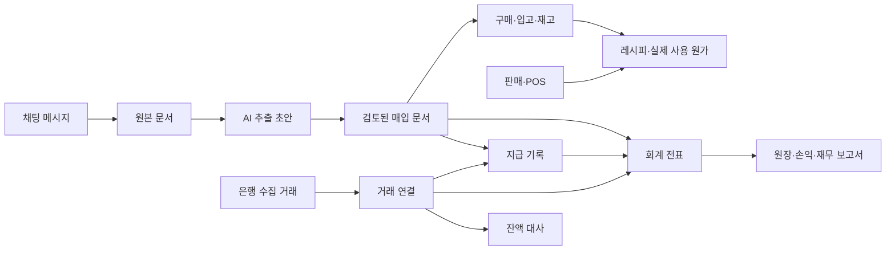

# ZC FNB 재설계 V2 — Restaurant365 화면 구조와 원가·회계·은행

2026-10-28 · V2 전체 계획서. 아래 내용은 단계별 목표이며 전체 구현 완료를 뜻하지 않는다.

**이미지 확보 후 범위 조정:** 사용자가 제공한 3묶음의 실제 참고 이미지를 확인했다. 최신 요청에 따라 전체 기능보다 화면의 큰 틀을 우선 구현하고 팀채팅은 유지한다. 이번 적용 범위와 제외 항목은 [이미지 선별·구현 기록](V2_REFERENCE_FRAME_IMPLEMENTED.md)을 기준으로 한다. 아래 회계·은행 전체 기능은 후속 목표다.

이 계획은 [기존 설계서](ZC_FNB_PRODUCT_REDESIGN_PLAN.md)의 화면 구성과 기능 범위를 대체한다. 채팅·영수증 유형 선택 제거·긴 근무 현황 정리에 대한 사용자 결정은 유지한다.

## 1. 목표 변경과 현재 상태

목표는 Restaurant365의 화면 체계와 주요 운영·재무 업무를 ZC FNB에서 사용할 수 있게 구성하는 것이다. 메뉴 몇 개와 색상을 바꾸는 수준으로 완료 처리하지 않는다. Restaurant365를 기준으로 화면의 영역·순서·상호작용을 대응시키고, 한글 가독성과 정보 밀도를 다듬는다. 팀채팅만 현재의 대화 중심 전체 화면을 유지한다.

| 영역 | 현재 구현 | V2 목표 |
|---|---|---|
| 공통 UI | 한 줄짜리 사이드 메뉴, 단일 운영 홈 | 모듈 전환 레일 + 하위 메뉴 + 글로벌 툴바 + 업무별 작업 공간 |
| 업무 목록 | 일부 상태·기간 필터와 표 | 저장된 보기, 열 표시·순서·정렬, 조건 필터, 행 선택, 일괄 작업, 페이지 이동 |
| 원가 | 최근 구매단가 × 레시피 사용량 | 메뉴 원가, 판매량 기반 이론 원가, 재고 기반 실제 사용 원가, 차이·원인 분석 |
| 회계 | 장부·전표·미지급금 없음 | AP/AR, 계정과목, 전표·원장, 손익·재무상태, 예산·기간 비교 |
| 은행 | 계좌·거래·대사·실은행 연동 모두 없음 | 계좌 관리, 연결 상태, 거래 수집, 매칭·규칙, 잔액 대사와 이력 |
| 채팅 | 전체 화면 대화, 영수증 첨부, 긴 근무표 정리 | 유지하고 새 구매·원가·회계 결과와 출처를 연결 |

현재 원가율을 Restaurant365 수준의 전체 원가·회계라고 설명하지 않는다. 실제 AI/OCR·기기 간 공유도 아직 미연결이다. 기존 121개 테스트는 이전 구현의 확인 결과이며 V2의 구현·완료 증거가 아니다.

## 2. Restaurant365 참고 기준

공식 최신 사용 문서에서 확인한 구조를 기준으로 한다. 문서에 새 기능·옵션으로 표시된 기능을 모든 R365 고객의 기본 화면이라고 단정하지 않는다. 구형 교육 자료와 현재 UI를 섞지 않는다.

| 참고 화면 | 확인한 구성 | ZC FNB에서 대응할 화면 |
|---|---|---|
| [Navigation](https://docs.restaurant365.com/doc/docs/r365-navigation) | 상단 툴바, 앱 전환 레일, 앱별 하위 메뉴 | 전체 업무 셸·메뉴 트리 |
| [Financial Dashboard](https://docs.restaurant365.com/docs/financial-dashboard-overview-security) | 기간 비교, 위젯, 저장된 보기 | 재무 홈 |
| [Operations Dashboard](https://docs.restaurant365.com/docs/operations-dashboard) | 운영 지표와 매출·인력 분석 | 운영 홈·매출 분석 |
| [AP Center](https://docs.restaurant365.com/doc/docs/ap-center-new) / [Workflows](https://docs.restaurant365.com/doc/docs/workflows-panel) | 처리 단계별 거래 목록·공통 표 도구 | 매입·지급 업무 센터 |
| [Draft Transaction](https://docs.restaurant365.com/docs/draft-transaction-details) | 문서 정보·품목·원본·활동 이력 | 영수증·거래명세서 검토 |
| [Menu Item Analysis](https://docs.restaurant365.com/docs/menu-item-analysis) | 가격·레시피 원가·판매량·메뉴별 수익성 | 메뉴 수익성 분석 |
| [Actual vs Theoretical](https://docs.restaurant365.com/docs/actual-vs-theoretical-analysis) | 실제/이론 사용량·원가와 차이 | 실제/이론 원가 보고서 |
| [Journal Entry](https://docs.restaurant365.com/doc/docs/journal-entry-record) | 전표 정보·차변/대변·첨부·승인 동작 | 전표 상세·원장 |
| [Bank Activity](https://docs.restaurant365.com/docs/bank-activity-page) | 은행 거래 목록·후보 매칭 패널 | 은행 거래 작업 공간 |
| [Bank Reconciliation](https://docs.restaurant365.com/doc/docs/bank-reconciliation) | 계좌·명세 기간·잔액·차이·거래 확인 | 은행 잔액 대사 |
| [Profit and Loss](https://docs.restaurant365.com/docs/profit-and-loss) | 계정별 손익, 매장·기간·예산 비교 | 손익 보고서 |

최초 계획 시 공식 문서의 일부 원본 이미지 링크를 불러오지 못했으나, 후속 작업에서 사용자가 제공한 로컬 원본 이미지와 연락판을 직접 확인했다. 참고 화면 선별과 이번 영역별 대응은 위 구현 기록에 정리했다. 고객 계정에서 실제 화면을 조작하거나 픽셀 단위 일치를 검증한 상태는 아니다.

대표 화면: ① 공통 셸 ② 재무 홈 ③ AP 센터 ④ 문서 검토 ⑤ 메뉴/원가 분석 ⑥ 은행 거래·매칭 ⑦ 잔액 대사 ⑧ 전표·손익. 각 화면에 참고 버전·확인일·원본 링크·대응 와이어프레임을 붙인다. 이미지가 확인되지 않은 영역은 ‘문서 기반 설계’로 표시하고 임의 배치를 R365 원형이라고 부르지 않는다.

## 3. 공통 화면 골격

### 데스크톱

```text
┌─────────────────────────────────────────────────────────────────────────────┐
│ 앱 전환 · ZC FNB │ 전역 검색 │ 새로 만들기 │ 알림 │ 도움말 │ 사용자          │
├───────┬─────────────────┬───────────────────────────────────────────────────┤
│ 모듈  │ 선택한 모듈의   │ 화면 제목 · 경로 · 사업장/법인 · 기간 · 주요 동작  │
│ 전환  │ 하위 메뉴       ├───────────────────────────────────────────────────┤
│ 레일  │                 │ 저장된 보기 / 업무 단계 탭                       │
│       │ 접기·펼치기     │ 검색 · 조건 필터 · 열 설정 · 내보내기            │
│ 홈    │ 고정/해제       ├─────────────────────────────┬─────────────────────┤
│ 보고서│                 │ 데이터 표                   │ 선택 행 상세/매칭   │
│ 회계  │                 │ 선택·정렬·열 조절·페이지     │ 필요할 때만 열기    │
│ 재고  │                 │                             │ 폭 조절·전체 화면   │
│ 매출  │                 ├─────────────────────────────┴─────────────────────┤
│ 인력  │                 │ 합계 · 선택 건수 · 페이지/처리 상태              │
│ 채팅  │                 │                                                   │
│ 관리  │                 │                                                   │
└───────┴─────────────────┴───────────────────────────────────────────────────┘
```

레일은 모듈을 바꾸고 하위 메뉴는 해당 모듈의 화면을 바꾼다. 현재 하나의 사이드바에 모든 기능을 나열한 방식을 교체한다. 상단 사업장·법인·기간은 각 업무에 맞춰 노출하며, 은행 거래일·회계 기간·영업일을 하나의 필터로 혼동하지 않는다.

테이블은 재사용 가능한 공통 컴포넌트로 만든다. 저장된 보기에는 필터·정렬·열 순서·열 표시·행 간격을 포함하고 사용자·사업장별로 보관한다. 상세를 닫으면 필터·페이지·선택 행·스크롤·키보드 초점을 복원한다. 이전/다음 기록 이동도 현재 필터 결과를 따른다.

표 행 클릭과 체크박스/버튼 동작은 구분한다. 일괄 동작은 현재 페이지 선택과 전체 검색 결과 선택을 명확히 나눈다. 미지원 일괄 승인을 버튼만 만들어 노출하지 않는다.

### 디자인 조정 범위

- 정보 구조·표·툴바·탭·상세 패널의 위치와 동작은 참고 화면을 우선한다.
- 정돈된 한글 폰트, 숫자 우측 정렬, 금액·단위·기준일 정렬, 적절한 행 간격, 명확한 오류·선택 강조로 가독성을 개선한다.
- 이미 같은 뜻인 상태 배지와 용어를 화면마다 다르게 만들지 않는다. 중요 경고를 색상만으로 구분하지 않는다.
- 큰 소개 배너·과도한 카드·장식으로 업무 표를 대체하지 않는다. 모든 홈을 같은 KPI 카드 모음으로 만들지 않는다.
- 레일 폭·행 높이·색상 수치는 참고 화면 확인 뒤 확정한다. 현재 코드의 색상을 기준 디자인으로 고정하지 않는다.

### 모바일과 채팅

업무 화면은 같은 분류를 유지하되 모듈 선택 서랍, 핵심 열 우선 목록, 전체 화면 상세로 대응한다. 보고서·대사 표는 필요한 경우 가로 스크롤을 제공한다.

채팅방 진입 시 업무 셸을 접고 방 목록/대화/입력창 중심 화면을 유지한다. 일반 대화는 분석하지 않는다. 직원별 긴 근무 현황 메시지에서만 정리를 실행하며 영수증은 유형 선택 없이 첨부·분석한다. 원문 메시지와 확정 업무 기록을 연결하고 돌아올 위치를 보관한다.

## 4. 전체 메뉴 체계와 기능 범위

| 모듈 | 이번 재설계에 포함할 주요 화면 |
|---|---|
| 홈 | 운영 홈, 재무 홈, 인력 홈, 처리할 일 |
| 보고서 | 보고서 목록·즐겨찾기·저장된 조건, 손익, 재무상태, 원장, 매입/미지급, 원가 차이, 메뉴 수익성, 지점 비교 |
| 회계 / 매입·지급(AP) | 업무 센터, 거래처, 매입 문서, 승인, 지급 예정/부분 지급/지급 기록, 반품·차감 문서 |
| 회계 / 매출채권(AR) | 고객, 외상 매출, 청구·수납 기록, 미수금 |
| 회계 / 은행 | 계좌·연결 관리, 거래 내역, 매칭 작업 공간, 규칙, 잔액 대사, 대사 이력 |
| 회계 / 일반원장(GL) | 계정과목, 전표, 원장·시산표, 예산, 회계 기간·마감 설정 |
| 재고·원가 | 문서 처리함, 식재료·거래처별 품목, 단위·규격, 발주·입고, 실사, 이동, 폐기, 레시피, 실제/이론 원가 |
| 매출·예측 | 일별 매출, 판매 내역, POS 메뉴·레시피 연결, 메뉴 수익성, 판매 구성, 예산·예측 비교 |
| 인력 | 직원, 근무표, 지난 근무 내역, 근무시간 비교, 인건비 집계, 급여 집계·내보내기 |
| 팀채팅 | 방 목록, 대화·첨부·검색, 영수증 분석 카드, 긴 근무 현황 정리·결과 카드 |
| 업무·운영일지 | 할 일, 공지, 운영 기록, 담당자·기한·완료 상태 |
| 관리 | 사업장·법인, 사용자·역할, 승인 흐름, 회계 기준, 은행/POS 연동, 데이터 가져오기, 표시 설정 |

은행·회계는 ‘다음에 추가할 아이디어’가 아니라 V2의 필수 화면 범위다. R365의 별도 전문 영역인 고정자산·프랜차이즈 정산·케이터링·채용·교육·미국 급여 세무는 확장 목록으로 관리한다. 이것까지 구현하기 전에는 ‘R365 모든 기능 완전 구현’이라고 부르지 않는다. 국내 급여·세무 신고·실제 송금도 조회·집계와 별도 외부 실행 기능으로 구분한다.

## 5. 원가율: 네 가지 숫자를 구분

| 지표 | 표시 기준 | 필요한 데이터 |
|---|---|---|
| 메뉴 1인분 예상 원가율 | 레시피 식재료 원가 ÷ 같은 기준의 판매가격 | 사용량·환산·수율·가격 기준·레시피 이력 |
| 판매 기준 이론 원가 | 메뉴별 판매량 × 적용 시점 레시피 원가 | POS/판매 자료, 메뉴 매핑, 레시피·단가 이력 |
| 재고 기준 실제 사용 원가 | 기초 재고 + 순매입 + 순이동 유입 − 기말 재고의 평가액을 바탕으로 산출 | 재고 실사, 반품/할인, 이동, 평가 방식, 기간 |
| 장부 기준 손익 원가·비용 | 설정한 회계 기준에 따라 기표된 매출원가·비용 | 계정 매핑, 전표, 회계 기간·마감 |

위 실제 사용 원가 식은 설계 설명용 기본 구조다. 폐기·반품·재고 조정의 포함 위치와 재고 평가 방식은 데이터 모델·서버 계산 규칙으로 고정한다. 서로 다른 방식의 숫자를 같은 ‘실제 원가’로 합치지 않는다.

원가 분석은 식재료/카테고리/매장/기간별 실제·이론·차이·폐기·설명되지 않은 차이를 표로 보고 원인을 펼쳐 확인한다. 메뉴 분석에는 판매가격·판매량·매출·원가·원가율·식재료 기준 기여이익·인기/수익성 구분을 둔다. 원가율은 금액 합계의 비율로 집계하며 행별 퍼센트를 단순 평균하지 않는다. 매출이 없거나 분모가 없으면 계산 불가로 표시한다.

구매금액은 그 기간에 사용한 재료 원가와 같지 않다. 식재료 마진은 매장 순이익과 같지 않다. 재고 원가 분석과 손익 보고서는 계산 기준·시점 차이를 설명하고 같은 수치라고 강제로 맞추지 않는다.

## 6. 회계 UI와 업무 흐름

### AP 업무 센터

처리 초안 → 검토/승인 대기 → 지급 준비 → 지급 묶음·지급 기록 → 지급 결과 확인 흐름을 제공한다. 반품·차감 문서는 별도 보기를 둔다. 초안의 정확한 상태·단계명은 실제 서버 계약에 맞춰 정한다.

공통 열은 거래처·문서 번호·문서일·만기일·총액·지급액·미지급액·사업장·담당자·상태다. 단계별 필요한 열과 동작만 보여준다. 지급 준비에서 선택한 문서를 지급 기록에 연결하고 부분 지급·합산 지급·차감 적용 후 남은 금액을 보여준다. 지급 기록을 만들었다는 것과 실제 은행 이체 완료는 구분한다.

### 전표·원장·보고서

- 계정과목: 번호·이름·계정 유형·상위 계정·활성 상태·사업장/법인 범위.
- 전표: 전표일·번호·적요·사업장, 차변/대변 행, 합계·차이, 원본 첨부, 분개 근거, 작성/승인/기표/취소 이력.
- 전표 합계 불일치·잠긴 기간·권한 부족은 동작을 제한하고 서버가 최종 검사한다. 취소·역분개는 원래 기록과 연결한다.
- 원장·시산표: 계정·기간·사업장 필터, 기초·차변·대변·기말, 전표로 이동.
- 손익: 매출·매출원가·인건비·기타 비용 등을 계정별로 펼치고 기간·지점·예산을 비교한다. 실제 기표된 자료와 예상값을 구분한다.
- 재무상태: 자산·부채·자본과 잔액 근거를 표시한다. 데이터가 없는 항목을 임의 숫자로 채우지 않는다.

AI 추출 결과만으로 계정·부가세·지급 여부를 확정하지 않는다. 현금 영수증·외상 거래명세서·가격 없는 납품서는 같은 채무 생성 규칙으로 처리하지 않는다. 문서 검토, 구매 반영, 회계 기표, 지급은 별도 상태다.

현재 승인된 구매 이력은 그대로 유지하되 회계 전표가 없는 자료를 ‘이미 기표됨’으로 옮기지 않는다. 기존 자료의 기초 이월·재고 잔액·미지급금 이관 기준이 필요하다.

## 7. 은행: 연결·조회·매칭·대사를 모두 설계

### A. 계좌·연결 관리

은행·계좌 별칭·마스킹 계좌번호·소유 법인/사업장·연결 상태·최근 성공 수집 시각·조회 잔액의 기준 시각을 보여준다. 연결 시작, 재인증, 연결 해제, 다시 동기화 동작과 권한을 정의한다.

연결 상태는 미연결/연결 중/연결됨/재인증 필요/수집 실패/해제로 나눈다. 실제 공급자 연결 확인 전에 UI만 성공으로 전환하지 않는다. 계좌 비밀번호·연동 비밀키는 프론트 저장소에 보관하지 않고 공급자 인증 또는 서버 연동 흐름을 쓴다.

### B. 은행 거래 작업 공간

```text
계좌 선택 · 조회 기간 · 최근 수집 시각                 [동기화] [파일 가져오기]
미연결 | 규칙 제안 | 연결 완료 | 제외
검색 · 조건 · 열 설정 · 내보내기
┌─────────────────────────────────────┬───────────────────────────────────┐
│ 거래일 | 입출금 | 금액 | 적요 | 상태 │ 선택 거래                         │
│ 실제 수집한 은행 거래 목록           │ 거래처/계정/사업장 · 후보/연결 근거 │
│ 선택·정렬·필터                      │ 관련 지급·전표·증빙 · 남은 차액    │
│                                     │ 검토 → 연결 / 연결 해제 / 제외     │
└─────────────────────────────────────┴───────────────────────────────────┘
```

수집한 은행 원문은 보존하고 거래처·계정 등 업무 분류는 별도 저장한다. 동일 거래 재수집을 중복 생성하지 않는다. 조회 실패 시 마지막 성공 자료와 수집 시각을 구분한다.

### C. 거래 연결·규칙

후보는 금액·거래일·거래처·계좌·참조번호 등을 근거로 보여준다. 여러 후보가 있으면 사용자가 고른다. 후보가 있다는 것과 연결이 확정됐다는 것을 구분한다.

우선 기존 지급·수납·은행 비용·전표를 찾고 관련 원본 영수증까지 연결한다. 기존 매입 문서를 은행 거래에서도 새 비용으로 등록해 이중 집계하지 않는다. 이체는 내부 계좌 간 이동일 수 있으며 일반 매출·비용으로 자동 분류하지 않는다.

합산 지급·분할 지급·환불은 연결 그룹과 배분액을 가진다. 합계가 맞지 않으면 차이를 남기고 확정을 막는다. 일대다 매칭의 상세 동작은 ZC FNB의 확장 설계이며 R365의 단일 매칭 패널과 동일하다고 주장하지 않는다. 규칙은 조건·적용 계좌·처리 제안·미리보기·활성 상태를 관리한다.

### D. 잔액 대사

계좌·명세 종료일·명세 잔액 → 장부 거래 확인 → 조정/차이 해소 → 대사 확정 → 이력·보고서 순서다. 수집한 은행 거래, 장부 잔액, 명세 잔액을 구분한다. 차이가 0이라는 것 외에 누락·중복·기간·권한 검사도 필요하다. 대사 이후 관련 거래 수정은 재확인 절차와 감사 기록을 거친다.

### E. 실제 국내 은행 연결

프론트 화면은 파일 가져오기·연결·거래 조회·대사까지 이번 범위에 포함한다. 실계좌 데이터 수집은 국내 공급자·지원 은행·개인/사업자/법인 계좌 범위·동의/갱신·샌드박스·요금·실서버 심사 조건을 확인한 후 연결한다. R365의 해외 연동을 그대로 붙이면 국내 은행도 된다고 가정하지 않는다. 실제 송금 실행은 조회·대사와 별도 계약·권한·처리 결과를 갖는 기능이다.

## 8. 연결되는 데이터 구조



핵심 식별자는 원문 메시지, 원본 문서, 추출 작업, 매입 문서, 구매/입고, 전표, 지급, 은행 거래, 연결 그룹, 대사 기록으로 나눈다. 원문/원본부터 보고서까지 출처를 추적할 수 있어야 한다. 공급자 거래 ID·원문 해시·요청 멱등 키·버전은 목적에 맞게 별도로 관리한다.

회계 기간·영업일·거래일·은행 처리일·통화·부가세 기준·단가/레시피 적용일을 계약으로 정한다. 잔액·원가·전표 반영은 백엔드가 최종 계산하고 버전·권한·트랜잭션을 검사한다. API 경로는 실제 명세 전까지 확정하지 않는다.

## 9. 화면 완성과 실제 연동을 구분하는 원칙

| 상태 | 제공할 동작 | 표시 원칙 |
|---|---|---|
| 명시적인 데모 | 준비한 자료로 검색·편집·저장·매칭·집계·대사를 끝까지 체험 | 데모 자료임을 화면에서 구분 |
| 실제 API 연결 | 같은 화면에서 서버 자료와 권한·상태를 사용 | 성공 응답과 재조회로 실제 처리 결과 확인 |
| 연결 설정 필요 | 설정·연결 시작 또는 파일 가져오기 안내 | 가짜 잔액·가짜 연결 성공을 만들지 않음 |

은행 메뉴 이름과 빈 페이지만 추가한 것을 구현 완료로 보지 않는다. 프론트 데모에서도 연결 상태 변경, 파일 검토, 거래 후보 선택, 연결 해제, 대사 저장까지 실제 상호작용이 있어야 한다. 반대로 로컬 저장 성공을 실은행 연결·실제 지급·법정 회계 처리 완료라고 부르지 않는다.

## 10. 구현 묶음과 완료 산출물

| 순서 | 개발 묶음 | 산출물·완료 기준 |
|---|---|---|
| 0 | 참고 화면 고정 | 대표 8화면의 영역·동작 대응표, 데스크톱/모바일 와이어프레임. 이미지 미확인 범위 명시 |
| 1 | R365 공통 UI 체계 | 모듈 레일·하위 메뉴·상단 툴바·저장 보기·공통 데이터 표·상세 패널. 대표 업무 화면에서 구조 확인 |
| 2 | 회계·은행 중심 대표 화면 | 재무 홈, AP 센터, 은행 거래·매칭, 대사, 전표 상세, 손익을 같은 셸에서 먼저 완성. 새 디자인의 기준 화면으로 삼음 |
| 3 | 원가·재고·매출 확장 | 레시피·구매·실사·이동·폐기·판매 매핑, 메뉴 분석과 실제/이론 원가, 근거 추적 |
| 4 | 나머지 업무 화면 | 거래처·고객·미수/미지급·수납·지급·원장·예산·재무상태·인력·업무일지·관리 |
| 5 | 채팅 연결·데이터 이관 | 현재 대화 UI 유지, 영수증·근무표와 새 문서/전표의 출처 연결, 이전 링크·저장 기록 보존 |
| 6 | 실제 서버·외부 서비스 연결 | AI·인증·공유·회계 계산·은행·POS 계약에 맞춰 순차 전환. 연동 완료와 화면 완료를 따로 기록 |

모든 화면을 같은 속도로 만드는 고정 일정은 지금 산정하지 않는다. 단계 0·1에서 공통 구조를 먼저 고정하고 대표 회계·은행 화면을 기준으로 확장한다. 앞선 구현처럼 기존 홈만 다듬고 원가·회계·은행을 다시 범위 밖으로 밀지 않는다.

## 11. 기존 코드 재사용과 교체

- 유지: `ChatPage`, 채팅 전용 viewport·키보드 처리, 영수증 형식 없는 업로드, 긴 텍스트 근무표 정리, 원본·문제 검토, 엑셀, 로그인·입력 보호, 사업장별 데이터 분리.
- 교체: `Layout`의 단일 사이드바, 단일 홈 중심 정보 구조, 페이지마다 개별 작성한 표/필터/상세 패널.
- 이전: 기존 문서·메뉴·가격·입고·근무표 페이지를 새 모듈 아래로 옮기고 기존 URL을 새 위치로 연결한다. 경로 검증·로그인 복귀 허용 목록도 함께 갱신한다.
- 추가: 셸·내비게이션 설정, 공통 표·저장 보기·상세 패널, accounting/banking/inventory/sales/reports 영역의 타입·어댑터·데모 저장소.
- 분리: AI 추출 문서와 회계 거래를 같은 `Receipt.status` 하나로 관리하지 않는다. 기존 승인 영수증에 회계 상태를 덧씌우기보다 별도 거래·전표와 연결한다.
- 백엔드 계약 전에는 제안 DTO와 실서버 확인 DTO를 문서에서 구분한다. 브라우저에 금융 연동 비밀키를 넣지 않는다.

## 12. 구현 검토 기준

1. 대표 화면에서 R365 원본과 주요 영역의 위치·순서·역할을 비교할 수 있는가?
2. 선택 모듈에 따라 하위 메뉴가 바뀌고, 공통 표와 상세 패널이 같은 방식으로 동작하는가?
3. AP 센터·전표·원장·손익·은행 거래·매칭·대사가 각각 독립적인 실제 화면과 연결 동작을 갖는가?
4. 메뉴 예상 원가·이론 원가·실제 사용 원가·장부 손익을 구분하고 계산 근거까지 이동할 수 있는가?
5. 은행 동기화·매칭·대사·지급을 같은 ‘완료’ 상태로 혼동하지 않는가?
6. 채팅의 일반 대화는 그대로이며 긴 근무 현황 정리와 영수증 분석만 명시적으로 시작되는가?
7. 데모 자료와 실제 계좌·실제 장부의 상태가 명확히 구분되는가?

이번에는 계획 수립만 진행한다. V2 구현이나 테스트·시각 검증을 완료했다고 기록하지 않는다.
